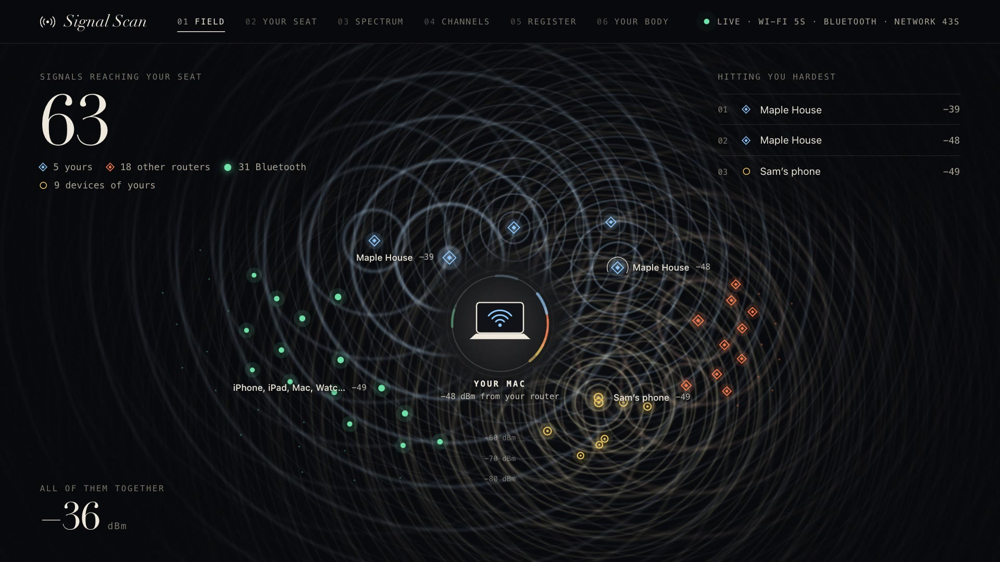
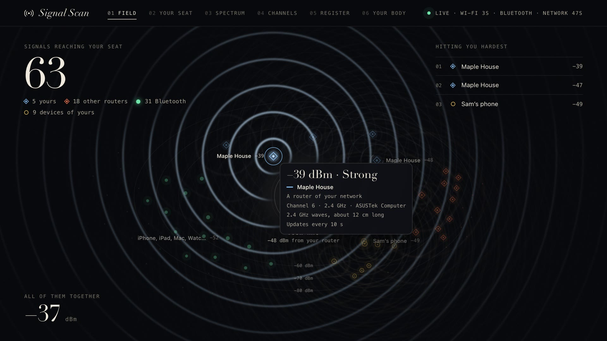
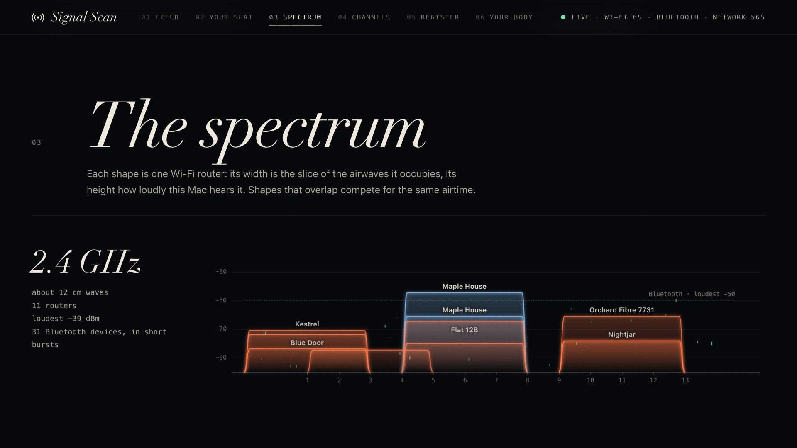

# Signal Scan

See every radio signal reaching your Mac, live: Wi-Fi routers, Bluetooth devices and the gadgets on your own network, drawn as a field of waves in your browser.



Your Mac sits at the centre. Every signal sits closer to it the stronger it arrives, and the strongest send out waves drawn in proportion to their band (2.4 GHz waves are twice as long as 5 GHz ones). Hover a signal to isolate its waves.



Everything stays on your Mac: no account, no analytics, nothing sent anywhere. The names in these pictures are invented.

## Install

Paste this into Terminal:

```bash
curl -fsSL https://raw.githubusercontent.com/ahmedasad89-design/signal-scan/main/install.sh | bash
```

It downloads the source, builds the app on your Mac (about a minute), puts Signal Scan in Applications and opens it at http://127.0.0.1:8377.

- **Needs** macOS 13 or later and Apple's free command-line tools. If they are missing, the installer opens Apple's window to install them; run the line again when that finishes.
- **Why it builds on your Mac:** an app built locally opens without a security warning. A downloaded copy would be blocked, because this project has no paid Apple developer certificate.
- **Want to read it first?** The whole installer is [install.sh](install.sh), one short script.

macOS then asks for three permissions. Allow all three:

| Permission | What it unlocks |
|---|---|
| Location Services | Wi-Fi network names (macOS hides them otherwise; your location is never read) |
| Bluetooth | The list of nearby Bluetooth devices |
| Local Network | The devices joined to your Wi-Fi (TV, cameras, phones) |

Leave the small Signal Scan window open; closing it stops the scan.

**Update:** run the same line again (macOS usually asks for Location and Bluetooth again after an update).

**Uninstall:**

```bash
curl -fsSL https://raw.githubusercontent.com/ahmedasad89-design/signal-scan/main/install.sh | bash -s -- --uninstall
```

## What it shows

1. **The field.** Every signal around your Mac, as waves. Where a signal sits is not its real direction (a laptop cannot sense direction); it is a picture of strength, not of any harm.
2. **Your seat.** Your own connection against the background noise, and whether your channel is crowded.
3. **The spectrum.** Each router as a shape on its band: how wide a slice of the airwaves it takes and how loud it is.
4. **Quieter channels.** How busy each channel is with other people's routers, so you can pick a calmer one.
5. **The register.** Every router, Bluetooth device and network device, with its maker.
6. **Your body.** What reaches you compared with the international exposure limit, and what the research says about sleep, headaches and thinking, with sources. It includes a blind sleep trial you can run at home.



## Privacy

- The app talks to nothing outside your Mac. Its page is served on `127.0.0.1` only, and it refuses requests from other sites.
- The installer makes two downloads: this source from GitHub, and the public list of device makers from the IEEE.
- It only searches a network for devices after you mark that network as your own (see below).
- Readings are not stored. The app remembers only which routers you marked as your own; the sleep trial is kept in your browser's storage on this Mac.

## Hearing your own devices

An ordinary scan only hears routers. Under Register → On your network, "Listen to my devices" puts the Mac's Wi-Fi card in listening mode for about half a minute and reports how strongly each of your devices (TV, cameras, phones) arrives at the Mac. They then appear in the list with a strength, and on the wave field as gold rings for a quarter of an hour.

- It only runs on a network you have marked as your own, because listening hears every device in range.
- macOS asks for an administrator password: the capture is made by the system's own `tcpdump`. The Mac drops off Wi-Fi while it listens and rejoins by itself.
- Only the first bytes of each frame are kept (addresses and strength, never content), the file is deleted once read, and devices on other people's networks are only counted, never listed.
- Strengths are a snapshot. A device that was idle or asleep may be missing.
- **This part is experimental.** It has been tested against hand-built captures, not yet on a live network. Some Macs and macOS versions do not allow listening mode. The page then offers to read a capture made with Apple's Wireless Diagnostics (Window → Sniffer) instead.

`SignalScan --air capture.pcap --own AA:BB:CC:DD:EE:FF` reads any capture file and prints what was heard, without touching a radio. (The program is inside the app, at `Contents/MacOS/SignalScan`.)

## Your body, and the sleep trial

The last chapter compares what the Mac hears with the international exposure limit and summarises the research on sleep, headaches, thinking and cancer, with its sources: what is established, what is unsettled and what points the other way. It is a summary of the science, not medical advice.

It also runs a blind sleep trial, for anyone who wants to know whether their own sleep changes with the Wi-Fi off. The app draws a random plan (half the nights on, half off), shows it only to a helper, takes a score each morning, and at the end compares the two kinds of night and says how likely the gap is to be luck.

The trial is kept in the browser's storage for `127.0.0.1:8377`, on this Mac only. It lives in the browser you started it in and is lost if you clear that site's data, so use "Download the log" to keep a copy.

## Good to know

- **It only searches networks you mark as yours.** Listing devices means sending a tiny packet to every address on the network, which is fine at home and not something to do at an office or on public Wi-Fi. The device list has a "This is my own network" button; until you press it, the network is left alone.
- **It only scans while the dashboard is on screen.** Each Wi-Fi scan slows the Mac's own connection for a few seconds, so scanning stops when the tab is hidden or closed.
- **Readings are for the spot where the Mac is.** Carry it to another room to survey that room.
- **What it cannot see:** mobile-network signal (5G, LTE, GSM), because a Mac has no cellular radio; and interference from things that are not Wi-Fi or Bluetooth, which only shows up as background noise.

## Build it yourself

```bash
git clone https://github.com/ahmedasad89-design/signal-scan.git
cd signal-scan
./build.sh
open build/SignalScan.app
```

This needs only the Xcode command-line tools (`xcode-select --install`), not Xcode. The app is signed ad hoc, so after a rebuild macOS usually asks for Location and Bluetooth again.

To label devices by maker, a build made this way needs the IEEE registry once (the installer does this for you):

```bash
mkdir -p ~/Library/Application\ Support/SignalScan
curl -o ~/Library/Application\ Support/SignalScan/oui.csv https://standards-oui.ieee.org/oui/oui.csv
```

The app serves `Resources/dashboard.html` straight from the source folder, so changes to the page show up on the next browser refresh without rebuilding. Rebuild only when something in `Sources/` or `Info.plist` changes. The page uses WebGL for the waves (with a simpler fallback without it) and fonts that ship with macOS.

`build/SignalScan.app/Contents/MacOS/SignalScan --selftest` checks the parsers without touching any radio.

## Licence

[MIT](LICENSE). Bug reports and fixes are welcome.
